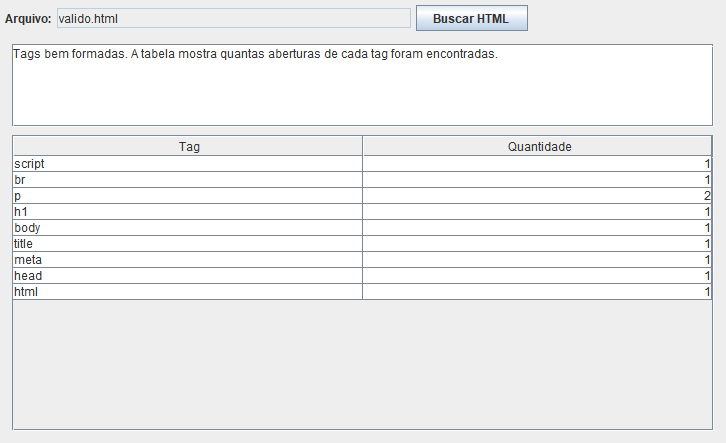

# Validador de estrutura HTML

Aplicativo Java que verifica a ordem de abertura e fechamento das tags de um arquivo HTML e conta as ocorrências. A interface usa Swing, e a validação utiliza uma pilha apoiada em lista encadeada.



## Executar

Requisitos: JDK 17 ou superior e PowerShell.

```powershell
.\build.ps1 -Test
.\build.ps1 -Run
```

Na interface, clique em **Buscar HTML** e selecione um arquivo `.html` ou `.htm`. O resultado mostra a contagem das tags ou a primeira inconsistência, com linha e coluna começando em 1. Cancelar a seleção mantém o resultado anterior. A leitura roda em segundo plano.

Também é possível executar no console, depois de compilar:

```powershell
java -cp build/classes trab.Main exemplos/valido.html
java -cp build/classes trab.Main exemplos/invalido.html
```

O console retorna código 0 em caso de sucesso, 1 em erro de sintaxe ou leitura e 2 para argumentos incorretos. Os arquivos devem estar em UTF-8.

## Funcionamento

- Verifica aninhamento e fechamento explícito, ignorando diferenças entre maiúsculas e minúsculas nos nomes das tags.
- Reconhece comentários em várias linhas e ignora tags dentro deles.
- Considera aspas simples e duplas ao procurar o fim de uma tag; `<` e `>` dentro de atributos não encerram a leitura.
- Aceita tags em várias linhas, atributos separados por tabulação e a declaração `DOCTYPE html`.
- Reconhece `area`, `base`, `br`, `col`, `embed`, `hr`, `img`, `input`, `link`, `meta`, `param`, `source`, `track` e `wbr` sem fechamento.
- Aceita a escrita de autofechamento, como `<custom-tag />`.
- Trata o conteúdo de `script`, `style`, `textarea` e `title` como texto até encontrar o fechamento correspondente.
- Conta somente as aberturas, incluindo tags sem fechamento. Comentários e DOCTYPE não entram na tabela.
- Uma nova análise zera o resultado anterior. Falhas não deixam uma contagem parcial.

## Limites

A ferramenta verifica estrutura e balanceamento com regras explícitas. Não substitui um validador completo de HTML: não confere nomes e valores de atributos, elementos permitidos em cada contexto ou fechamentos opcionais. Por exemplo, exige `</li>` e `</p>` mesmo em situações em que um navegador pode completar esses fechamentos. Conteúdo sem tags é aceito.

## Testes

Os testes cobrem comentários, aspas, scripts, tags incompletas, ordem dos fechamentos, contagem, análises repetidas, localização de erros, falhas de leitura e as operações da lista e da pilha. Compilação com `-Xlint:all -Werror`, sem bibliotecas externas.

Origem: pacote `trab` do arquivo `src.zip`, com as dependências `Lista03` e `Lista05`. As listas e a fila dos outros pacotes não fazem parte deste aplicativo.
